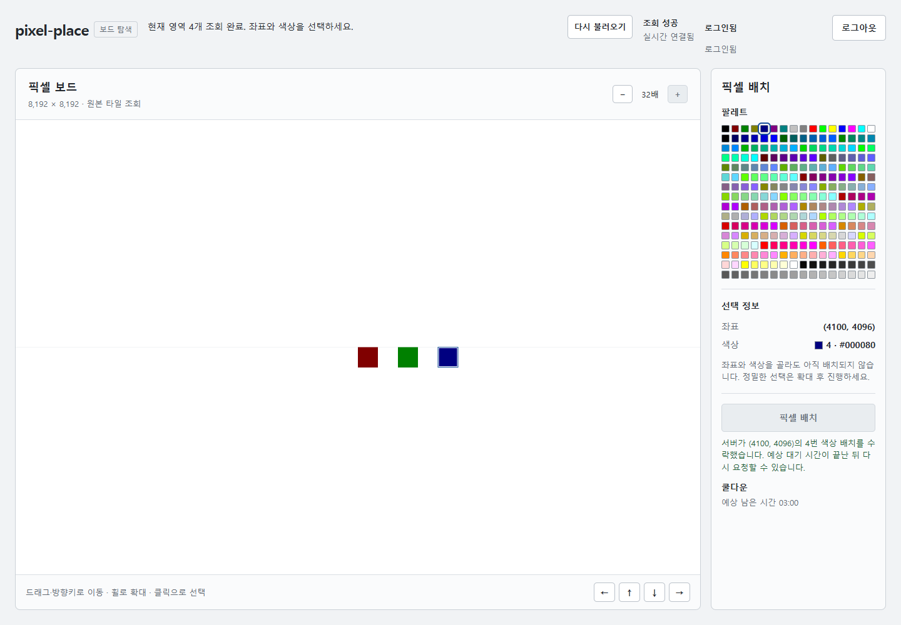
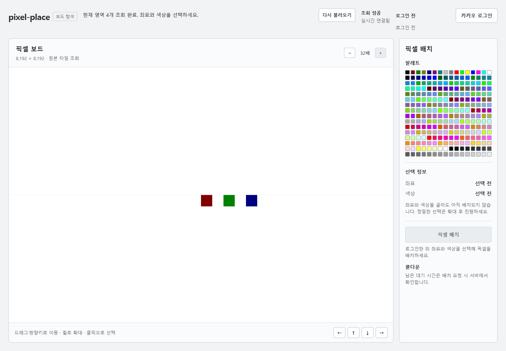
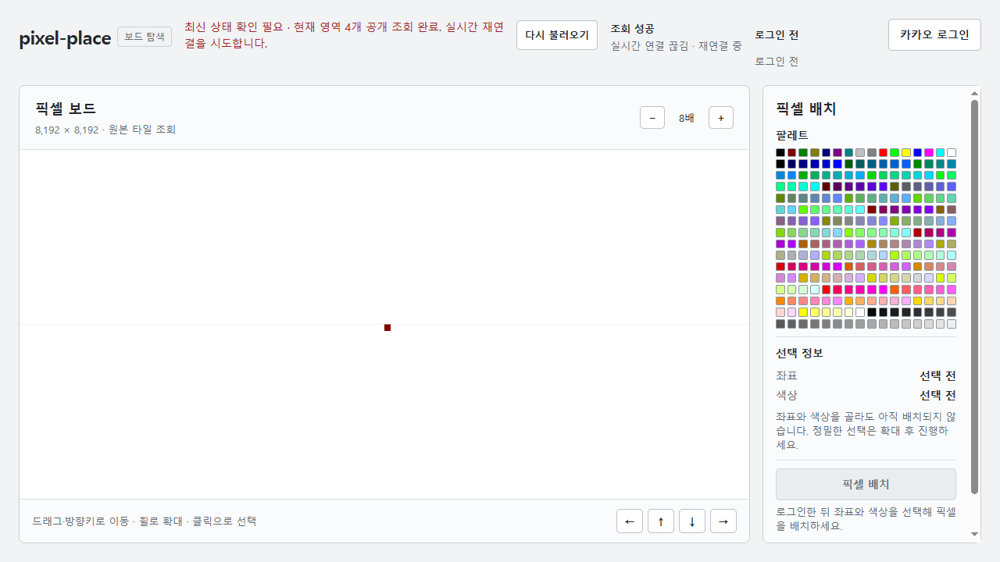
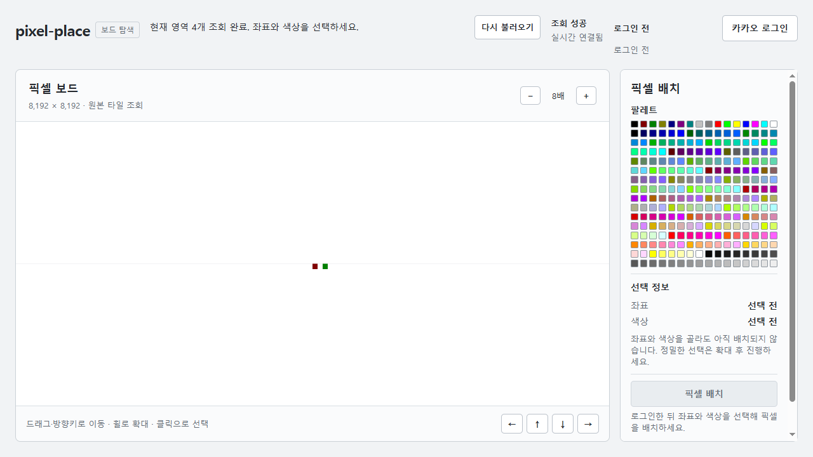

# pixel-place — 실시간 픽셀 보드와 쓰기·복구 경계

Java/Spring 백엔드 포트폴리오 · 3~5분 요약 · 작성 기준 2026-10-27 · 순서 보장 설명 보완 2026-11-10

## 1. 프로젝트 소개

여러 사용자가 **8,192×8,192 픽셀 보드를 함께 채우는 서비스**다. 비로그인 사용자는 보드를 이동·확대하며 변경을 실시간으로 보고, 카카오 로그인 후 좌표와 256색 팔레트에서 색을 골라 픽셀을 배치한다. 사용자별 배치 간격은 180초다.

핵심 과제는 **동시 쓰기의 순서, 성공 응답의 조건, 저장 결과가 불확실할 때의 복구**를 일관되게 정의하는 것이었다. 메모리를 현재 상태의 기준으로 삼고 WAL로 쓰기를 내구화한 뒤 DB에 비동기로 반영한다.

현재 완료 범위는 **localhost 데스크톱 최소 데모**다. 2026-10-21 Windows·Edge 155에서 실제 로그인, 배치, 비로그인 브라우저 반영, 새로고침과 재연결 복구를 확인했다. 아래 내용은 기존 실행 증거와 현재 코드 확인을 구분해 정리했으며, 현재 전체 성능 검증이나 공개 배포 완료를 뜻하지 않는다.

## 2. 주요 기술과 구현 역할

| 기술 | 프로젝트에서 맡는 역할 |
| --- | --- |
| Java 21 · Spring Boot | 인증된 HTTP 쓰기, 동시성 제어, 부팅 복구와 flush 작업의 경계를 구성 |
| MySQL | 사용자 식별 정보와 후행 저장소. 픽셀 이벤트·타일·checkpoint를 한 transaction으로 반영 |
| Redis | 사용자별 쿨다운 확인·저장. 실시간 픽셀 상태의 기준은 서버 메모리 |
| 파일 WAL | DB 반영 전에 이벤트 순서와 내구성을 확보하고, 재시작 시 미반영 이벤트를 재생 |
| WebSocket · Canvas | 공개 변경을 브라우저에 전달하고 필요한 타일만 표시. snapshot과 변경을 버전 기준으로 병합 |

구현 범위에는 카카오 OAuth2·Access JWT, 쓰기·조회·저장·복구 경로, 데스크톱 보드 UI와 검증 코드가 포함된다.

## 3. 핵심 처리 구조

**쓰기:** 인증·사용자별 gate/쿨다운 확인 → 쓰기 순서 확정 → WAL append·fsync → 메모리 적용 → dirty mark(후행 저장 대상 등록) → 후처리·HTTP 수락/WS 전파.

| 경계 | 완료의 의미 |
| --- | --- |
| WAL / 메모리 | WAL 내구화가 먼저이며, 메모리 적용까지 성공해야 core write 완료 |
| HTTP 수락 | core write와 dirty mark 완료. DB flush나 모든 브라우저 수신 완료는 조건이 아님 |
| DB flush / checkpoint | 이벤트와 타일을 함께 저장한 지점까지만 checkpoint 전진 |
| WebSocket / Canvas | 해당 브라우저가 받은 변경을 표시. HTTP와 WS의 관측 도착 순서는 다를 수 있음 |

**서버 재시작:** DB snapshot·checkpoint 로드 → checkpoint 이후 WAL 재생 → 메모리·다음 순서 번호 복구 → 서비스 준비. 브라우저 재연결은 이 과정과 별개로, 새 GET으로 현재 영역을 조회하고 수신 변경을 병합한다.

## 4. 대표 문제 해결 사례

### ① 동시 쓰기와 WAL 수락·복구 경계

- **문제:** 같은 사용자의 경쟁 요청이 쿨다운을 함께 통과하거나, 전체 WAL 기록 순서와 메모리 적용 순서가 어긋나면 수락·복구 기준이 흔들린다.
- **선택과 이유:** 사용자별 gate와 전체 쓰기 순서 제어를 분리했다. WAL 내구화 후 메모리·dirty를 처리하여, DB 저장 지연과 관계없이 수락 경계를 정했다.
- **결과:** 기존 동시성·실패 주입 테스트는 중복 진입과 WAL/메모리 실패 뒤의 후속 처리를 검사한다. 2026-09-29의 제한된 group 미flush 복구 실행에서는 두 이벤트 재생과 순서 복구, 준비 완료 뒤 flush를 확인했다.
- **한계:** 현재 group은 FIFO 게시 순서를 기준으로 하며 HTTP 최초 접수 선착순은 보장하지 않는다. 응답 미수신은 서버 효과 부재를 뜻하지 않는다. 오류 때 이미 WAL·메모리에 효과가 남을 수 있어 프런트는 결과 미확정을 표시하고 자동 재전송하지 않는다. 모든 장애의 무손실이나 분산 writer 보장은 검증하지 않았다.

[쓰기 경계 코드](../src/main/java/dev/cgt/pixelplace/pixel/application/GroupPixelWriteExecutor.java) · [동시성 테스트](../src/test/java/dev/cgt/pixelplace/pixel/application/PixelCommandConcurrencyTest.java) · [서버 복구 코드](../src/main/java/dev/cgt/pixelplace/recovery/application/StartupRecoveryService.java)

### ② DB commit 결과 불확실성 처리

- **문제:** commit 요청 뒤 예외가 나면 DB가 반영했는지 모를 수 있다. 즉시 재시도하거나 성공으로 간주하면 중복 반영 또는 누락 위험이 있다.
- **선택과 이유:** 불확실한 작업을 pending으로 보존하고 다음 flush에서 먼저 판정한다. checkpoint와 타일 초기화 상태가 정확한 목표 상태면 commit, 정확한 이전 상태면 rollback으로 확정하며, 둘 다 아니면 pending을 유지한다. rollback 확정 때만 해당 작업에서 가져간 dirty를 복원한다.
- **결과:** 2026-09-29 MySQL 8.4.11 통합 테스트에서 **실제 commit 뒤 합성 응답 유실을 주입**하여 pending 보존 후 동일 flush를 재실행하지 않고 확정하는 경로를 확인했다. 해당 과거 suite는 40개, 실패·오류·건너뜀 0이었다.
- **한계:** 실제 네트워크 장비 장애를 재현한 결과가 아니며, 과거 테스트 성공을 현재 애플리케이션 전체 회귀 결과로 확대하지 않는다.

[정확한 상태 판정 코드](../src/main/java/dev/cgt/pixelplace/flush/application/FlushReconciliationService.java) · [MySQL 통합 테스트](../src/test/java/dev/cgt/pixelplace/flush/infra/FlushPersistenceMySqlIntegrationTest.java)

### ③ group commit 비교와 채택 판단

- **문제:** 요청마다 WAL force를 수행하는 single 방식의 비용을 줄이려면, force를 묶는 group 방식의 지연 개선과 큐·메모리·DB 비용을 함께 봐야 했다.
- **선택과 이유:** C4에서 같은 픽셀 집중(same)과 여러 타일 분산(spread)을 각각 3회 비교했다. **개선 관측과 목표 달성을 별개로 판단**했다.

2026-09-23 C4의 spread 성공 요청 RTT p95(ms)는 다음과 같다. Windows 10/NTFS·JDK 21.0.10/G1, 같은 PC 자원 공유, 서버 heap 2GiB/발생기 512MiB, 계획 쓰기 105/s·WS 100연결, 예열 30초+측정 120초 조건이다. 미송신은 성공 RTT 표본에서 제외했다.

| 반복 | single | group |
| --- | ---: | ---: |
| 1 | 492.0067 | 156.1474 |
| 2 | 562.4612 | 180.3960 |
| 3 | 555.8881 | 172.1860 |

- **결과·판단 변화:** 세 반복 모두 개선됐지만 group spread도 p95 목표 100ms에 미달했고 p99는 반복 2·3에서 목표 250ms를 넘었다. 두 mode 모두 전체 목표 충족은 6회 중 3회(same 통과)였다. C4는 single 유지·group 제거로 마감했으나, **C5는 개선 효과를 활용하기로 결정을 바꿔 group을 일반 기본값으로 채택**했다. C5는 C4 성능 자료를 재사용했으며 별도 짧은 smoke를 새 대표 성능 비교로 세지 않는다.
- **후속 판단·한계:** 2026-10-02 **18-C1은 채택할 개선 근거가 부족해 production 변경 없이 마감**했다. 당시 기록은 타일 작업량의 비용 기여 정황을 남겼지만 HTTP 지연의 지배 원인·특정 개선 효과는 확정하지 못했다. 이 판단은 진행 기록 확인 수준이며 새 분석이 아니다. heap·일부 DB·디스크 비용 증가가 해결됐거나 현재 성능이 같은 비율로 개선됐다고 주장하지 않는다.

[현재 실행 모드 선택 코드](../src/main/java/dev/cgt/pixelplace/pixel/application/WriteExecutionConfiguration.java) · [모드 설정 테스트](../src/test/java/dev/cgt/pixelplace/pixel/application/WriteExecutionConfigurationTest.java)

## 5. 실제 동작 확인

다음은 기존 실제 캡처 4장이다. 인증 입력·토큰은 포함하지 않았다. **19-6의 실시간 반영과 19-5의 재연결 복구는 서로 다른 실행**이며, 합성 UI 응답으로 만든 화면이 아니다.

### 19-6 · 로그인한 A의 배치 → 비로그인 B의 실시간 반영

2026-10-21 23:41 KST. 정상 카카오 로그인 후 A의 `(4100, 4096)` 남색 배치가 HTTP 200으로 수락됐고 `eventSeq=4`, `tileVersion=4` 및 예상 03:00을 확인했다. DB flush 완료 화면을 뜻하지 않는다.

별도 컨텍스트의 비로그인 B가 같은 이벤트를 받아 흰 칸을 남색으로 표시했다. 초기 조회가 끝난 뒤 이 이벤트를 관측한 구간의 추가 타일 GET은 0건이며, 모든 관전자에 대한 전달률 측정은 아니다.

### 19-5 · 단절 중 미반영 → 새 연결의 GET으로 복구

2026-10-21 14:50 KST의 별도 실행. 검증용 라우팅으로 B 연결만 잠시 차단한 동안 A의 `(4098, 4096)` 녹색 배치는 수락됐지만 B는 해당 프레임을 받지 못해 흰색을 유지했고, 상단에 최신 상태 확인 필요를 표시했다.

첫 자동 재연결 후 **새 타일 GET**이 version 3·color 2를 반환하여, 적갈색 픽셀 오른쪽 칸이 녹색으로 복구됐다. WS 재전송은 없었으며, 짧은 B 단절 시험을 장기 네트워크 장애 검증으로 확대하지 않는다.

## 6. 한계와 추가 자료

CAP(부하·용량 검증)·W1·D-2 최종 전체 회귀와 현재 전체 성능 검증, 공개 배포는 완료 범위 밖이다. 실제 BFCache 복원, 모바일·다른 브라우저 확대도 미확인이다. Access는 최대 15분·자동 갱신 없음이며, WS는 화면별 구독 없이 전체 연결에 전파한다.

**확인 수준:** 화면은 2026-10-21 실제 실행의 원본 재사용, 백엔드 테스트·성능값은 명시한 날짜의 과거 증거다. 현재 코드·assert를 읽은 정적 확인과 구분하며, 이번 작성에서 서비스나 테스트·성능 측정을 다시 실행하지 않았다.

- [상세 문제 해결 설명](portfolio.md): 세 사례의 실패 분기와 판단 배경.
- [선별 근거표와 측정 조건](portfolio-evidence.md#group-comparison): C4의 세 반복 전체 표·집계 기준과 C5 판단. 문서에 기록된 로컬 원시자료는 저장소에 포함되지 않으며 외부 열람용 링크가 아니다.
- [브라우저 병합 코드](../frontend/tile-merge.mjs) · [병합 테스트](../frontend/tests/tile-merge.test.mjs): 역순·중복 이벤트와 늦은 snapshot 처리.
- [실행·정상 종료·시연 안내](../README.md): 기존 로컬 환경 전제와 데모 순서. 별도 공개 서비스 주소는 없다.

이 문서의 조건·결과·한계와 포함된 화면은 로컬 원시자료를 열지 않아도 읽을 수 있도록 정리했다.
