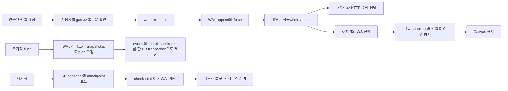

# pixel-place — 픽셀 하나의 수락부터 저장·표시·복구까지

pixel-place는 여러 사람이 하나의 픽셀 보드를 함께 채우는 서비스다. 로그인하지 않아도 보드를 탐색하고 다른 사람의 변경을 볼 수 있고, 카카오 로그인 후 좌표와 색상을 선택해 픽셀을 배치할 수 있다. 보드는 8,192×8,192이며 256색을 사용한다. 브라우저는 화면에 필요한 256×256 타일만 읽어 Canvas에 표시하고, 정상 연결에서는 WebSocket으로 받은 변경을 병합한다.

이 프로젝트에서 집중한 문제는 동시에 들어온 쓰기를 어떤 순서로 확정하고, 그 결과를 메모리·파일·DB·다른 브라우저에 어떻게 연결할 것인가였다. 응답이 늦거나 연결이 끊겼을 때도 ‘서버가 수락함’, ‘DB에 반영됨’, ‘화면에서 확인함’을 구분해야 한다. 이를 위해 메모리를 실시간 기준 상태로 두고, WAL을 쓰기의 첫 내구성 경계로 사용하며, DB 저장과 화면 전파를 별도 흐름으로 구성했다.

현재 완료 범위는 **19단계의 localhost 데스크톱 최소 데모**다. 2026-10-21의 실제 로그인·배치·비로그인 관전자 반영·새로고침·쿨다운 거절과 별도 재연결 검증 자료가 있다. 이 글은 2026-10-23에 현재 소스와 기존 자료를 대조해 작성했으며 새 성능 측정은 하지 않았다. CAP·W1·D-2·공개 배포와 프로젝트 전체 성능 검증은 완료 범위에 포함하지 않는다. 주장별 근거와 확인 수준은 [근거 문서](portfolio-evidence.md)에 모았다.

## 구현 범위와 처리 흐름

백엔드는 Java·Spring Boot, MySQL, Redis와 파일 WAL을 사용한다. 프런트는 HTML/CSS/JavaScript와 Canvas로 구성했다. 카카오 OAuth와 서비스 Access JWT를 연결했고, 사용자별 180초 쿨다운, 공개 타일 조회, 픽셀 쓰기, 공개 raw WebSocket 수신을 구현했다. 프런트는 이동·확대/축소·선택·배치 외에도 수락/거절/결과 미확정, 연결 상태와 현재 영역의 동기화 상태를 각각 안내한다.

이 도식의 HTTP와 WS는 관측 도착 순서를 뜻하지 않는다. 실제 시연에서도 WS 프레임이 HTTP 응답보다 먼저 보였다. flush는 쓰기 요청과 별도로 실행되며, DB 작업 동안 write coordinator를 계속 점유하지 않는다.

| 경계 | 여기서 확인할 수 있는 것 | 여기까지 보장하지 않는 것 |
| --- | --- | --- |
| WAL append·force | 파일에 기록한 쓰기의 첫 내구성 경계 | 메모리 적용·HTTP 수락·전원 장애 전체 보장 |
| core write | WAL 내구화와 메모리 적용 완료 | dirty mark·DB flush·브라우저 수신 |
| HTTP 수락 | core write와 command 계약의 dirty mark 완료 | DB flush 완료·모든 관전자 전달·브라우저의 실제 응답 수신 |
| DB checkpoint | 해당 지점까지 events와 tiles가 함께 반영됨 | 그 이후 WAL이나 아직 전송 중인 HTTP의 결과 |
| WS 수신·Canvas 표시 | 해당 클라이언트에서 변경을 받아 표시한 관측 | 특정 미확정 POST의 성공 증명·전체 저장/복구 검증 |

## 기존 시연으로 확인하기

실행 환경과 조작 순서는 [README](../README.md#짧은-시연)를 따른다. 이미 남긴 시연 HTML과 캡처의 위치는 [시연 근거](portfolio-evidence.md#demo-evidence)에 연결했다. 로컬 파일이며 공개 시연 URL이나 영상은 없다.

시연은 A의 로그인과 좌표·색상 선택에서 시작한다. A가 한 번 배치하면 수락 안내와 예상 대기 시간이 나타나고, 별도 비로그인 B 화면에 같은 픽셀이 나타난다. A를 새로고침하면 현재 타일을 다시 읽는다. 쿨다운 중 사용자가 다시 누른 요청은 서버가 429로 거절하며 화면의 예상 타이머를 보정한다. 19-6에서는 실제 픽셀 POST 2건 중 1건 수락·1건 거절을 확인했다.

새로고침의 최종 화면은 최초 캡처가 조회 중이어서 429 뒤 추가 쓰기 없이 보완한 자료다. 재연결 장면은 같은 날 앞선 **19-5의 다른 실행**을 재사용한다. B가 단절된 동안 놓친 변경을 첫 자동 재연결 뒤 새 타일 GET으로 복구했다. 이를 19-6의 연속 촬영이나 WS replay 기능으로 설명하지 않는다.

## 사례 1 — 동시 쓰기의 순서와 ‘수락’을 같은 경계에 묶기

**문제.** 여러 요청이 같은 픽셀이나 타일을 바꾸면 요청 도착 순서, WAL에 기록된 순서, 메모리에 적용한 순서가 어긋날 수 있다. 같은 사용자의 요청 두 개가 쿨다운 확인을 동시에 통과하는 문제도 별개다. 순서 번호만 발급하거나 메모리에 먼저 색을 칠하는 것으로는 실패 뒤 어느 상태를 복구해야 하는지 정할 수 없다.

**관측·원인.** MVP 동시성 기록은 동일 사용자 중복 수락과 서로 다른 사용자 쓰기의 순서를 검증하는 데 초점을 두었다. 현재 테스트는 같은 사용자의 경쟁 요청에서 한 건만 수락되는지, 서로 다른 사용자 요청의 WAL·memory 순서가 일치하는지 확인한다. WAL 실패, memory 실패, dirty mark 실패를 각각 주입해 후속 처리 여부도 검사한다. 이는 현재 코드와 테스트의 경계를 설명하는 근거이며, 운영 중 실제 데이터 유실 사고가 발생했다는 기록으로 사용하지 않는다.

**선택·판단.** 사용자별 gate는 한 사용자의 쿨다운 확인부터 쓰기·쿨다운 저장까지 보호하고, write coordinator는 사용자와 무관한 이벤트 순서·WAL·메모리 변경을 직렬화한다. 두 책임을 나눈 덕분에 사용자별 중복 진입을 막는 규칙과 전체 쓰기 순서를 보장하는 규칙을 독립적으로 검증할 수 있다. DB flush 완료를 수락 조건에 넣지 않고 WAL을 첫 내구성 경계로 유지하는 것은 프로젝트의 기존 설계 계약이다. 이 글에서 새로 제안한 최적화로 표현하지 않는다.

**구현.** 단건 경로는 순서 번호를 정한 뒤 WAL append와 force를 마치고 메모리에 적용한다. 현재 기본인 group 경로도 batch의 WAL을 먼저 내구화한 뒤 순서대로 메모리를 적용하고 각 요청의 dirty mark를 수행한다. 성공한 결과만 command 후처리로 돌아가며, WS 전파는 사용자 gate 밖에서 수행한다. WAL 또는 memory 단계의 실패는 재시작 전까지 새 write와 flush plan 생성을 막는 write 실패 상태로 이어진다. 정상적으로 소유한 기존 pending의 결과 판정은 유지하며, pending의 소유권 자체가 불명확한 더 강한 fatal 상태와 구분한다. 이미 기록된 효과가 있을 수 있는 오류를 단순 미기록으로 바꾸지 않는다. dirty mark 실패도 HTTP 성공이 될 수 없지만 WAL·메모리 효과가 이미 남을 수 있다.

복구는 DB checkpoint 이후 WAL을 재생하여 메모리와 다음 순서 번호를 되살린다. 브라우저의 상태 복구는 이 서버 복구와 다르다. 브라우저는 snapshot 버전과 픽셀별 최신 변경을 비교하고, 늦은 GET에 더 새로운 변경을 다시 병합한다. 타일 전체 최댓값 하나로 이벤트를 버리면 다른 픽셀의 유효한 변경까지 잃을 수 있으므로 픽셀별 기준을 사용한다.

**검증·결과.** 기존 동시성 테스트의 성공 XML과 현재 assert를 확인했고, 17단계의 group 미flush 상태 복구 trace에서는 checkpoint 이후 두 이벤트의 재생·순서 seed·READY 이후 flush 순서를 확인했다. 프런트 병합 테스트는 같은 픽셀의 오래된 변경을 거부하면서 다른 픽셀의 낮은 버전은 수용하고, HTTP/WS 도착 순서가 바뀌어도 같은 결과로 수렴하는지 검사한다. 19단계 실제 B 화면 반영과 재연결 GET 복구는 사용자에게 보이는 경로를 보완한다. 서로 다른 시점의 이 증거들을 하나의 대규모 장애 시험으로 합치지 않는다.

**한계.** 이 결과는 전원 장애, native I/O의 영구 정지, 모든 동시 요청 또는 모든 네트워크 실패에서의 무손실을 입증하지 않는다. 응답 미수신은 서버 효과 부재와 다르므로 프런트는 결과 미확정을 표시하고 자동 재전송하지 않는다. CAP의 과거 45건은 효과·복구를 확인했어도 원래 HTTP 응답은 미확정이며, 다른 실행의 새 3건은 개별 효과·정합성·새 JVM 복구가 미완료다. 두 집단의 상태를 서로 대신하지 않는다.

## 사례 2 — DB commit 응답을 잃었을 때 rollback으로 단정하지 않기

**문제.** DB에 commit을 요청한 뒤 예외가 발생하면 transaction이 취소됐을 수도 있고, DB는 이미 commit했지만 애플리케이션이 결과를 받지 못했을 수도 있다. 두 경우를 모두 실패로 처리해 dirty를 즉시 복원하면 이미 반영한 plan을 다시 실행할 수 있고, 성공으로 처리하면 반영하지 못한 데이터를 건너뛸 수 있다.

**관측·원인.** 11-B 실행 계약은 commit 성공·확정 rollback·결과 불확실을 별도 결과로 요구한다. 후속 MySQL 통합 테스트는 실제 DB commit 뒤 시험용 wrapper가 ambiguous 결과를 반환하도록 하여 이 분기를 재현한다. 따라서 검증한 것은 실제 MySQL transaction과 애플리케이션의 불확실성 처리 연결이다. 실제 네트워크 장비나 DB 프로세스 장애로 commit 응답이 소실된 실험이라고 쓰지 않는다.

**선택·판단.** 실패하면 모두 rollback으로 간주하는 방식과 checkpoint가 목표 이상이면 성공으로 간주하는 방식은 활성 계약이 명시적으로 배제한다. 채택한 기준은 기대한 이전 checkpoint와 목표 checkpoint의 **정확한 일치**, 그리고 DB 타일 초기화 상태의 조합이다. 무엇을 확인해야 재시도를 허용할 수 있는지를 좁혀, 모르는 상태를 임의로 성공 또는 실패로 바꾸지 않는다.

**구현.** flush worker는 immutable plan을 만들고 `pixel_events`, 타일 snapshot, checkpoint를 하나의 DB transaction에 반영한다. commit이면 그 plan에서 가져온 dirty를 소비하고, 확정 rollback이면 실제로 drain한 dirty만 복원한다. 그 사이 새 쓰기가 등록한 dirty는 별도로 남는다. ambiguous이면 drain한 dirty를 즉시 복원하지 않고 pending으로 보존하며, 다음 flush에서 pending 판정을 먼저 수행한다.

별도 DB probe는 checkpoint와 bootstrap 상태를 같은 일관된 관측으로 읽는다. 정확한 목표 상태면 commit으로 확정하고 pending을 해제한다. 정확한 이전 상태면 rollback으로 판단해 pending dirty만 복원한다. 둘 다 아니면 pending을 유지한 채 실패시켜 새 plan으로 덮지 않는다. DB I/O와 이 판정 동안 write coordinator를 점유하지 않는 것도 쓰기 경로와의 중요한 경계다.

**검증·결과.** 17-C4에서 실행한 실제 MySQL 8.4.11 통합 XML과 현재 테스트 assert를 대조했다. commit 응답 유실 주입 뒤 pending 보존과 중복 insert 없는 확정, rollback 뒤 dirty 복원, probe가 checkpoint 잠금 해제를 기다린 뒤 확정된 DB 상태를 읽는 사례가 포함돼 있다. reconciliation이 write coordinator를 점유하지 않는 구조는 현재 호출 경로를 별도로 읽어 확인했다. fresh runtime A→B→C→D 시험은 같은 MySQL 상태와 WAL bytes만 유지하고 메모리 객체를 새로 구성해, flush된 이벤트의 재생 생략과 미flush 이벤트 복구·후속 flush를 확인한다. 이 사례는 **같은 JVM 안의 runtime 재구성**이며 새 JVM 재시작 시험으로 바꾸어 쓰지 않는다.

**한계.** XML은 과거 해당 입력에서의 성공 증거다. 이번에 대조한 핵심 구현·통합 테스트 파일은 당시 입력과 일치하지만, 현재 전체 애플리케이션의 재회귀나 모든 실제 DB 장애 검증을 뜻하지 않는다. 새 운영 장애 내성을 주장하려면 장애 종류와 관측 지점을 따로 정해야 한다. 현재 포트폴리오의 핵심 설명인 ‘결과 불확실을 보존하고 정확한 상태로 판정한다’는 기존 구현과 시험으로 작성할 수 있다.

## 사례 3 — group commit의 개선 효과와 목표 달성을 분리해 채택하기

**문제.** 요청마다 WAL force를 수행하는 single 방식은 내구성 경계가 단순하지만 저장 장치 대기 비용을 요청마다 부담한다. group commit은 모인 쓰기의 force를 묶을 수 있지만 큐 대기·종료·불확실 요청 처리가 복잡해진다. 평균 처리량 하나만으로 채택하면 tail latency와 후행 DB 저장 비용을 놓칠 수 있다.

**관측·원인.** 15-C4는 같은 픽셀에 쓰는 same과 여러 타일에 분산하는 spread를 각각 세 번 비교했다. spread에서 group의 성공 RTT p95는 single보다 세 반복 모두 낮았지만, 두 mode 모두 목표를 만족한 실행은 6회 중 3회였다. same은 통과했고 spread는 p95 목표 100ms를 충족하지 못했다. force/event 감소는 관측됐지만 DB·heap·디스크 비용 증가의 원인을 모두 규명한 것은 아니다.

**선택·판단.** C4 당시에는 목표 미달과 비용을 고려해 single을 유지하고 group을 제거했다. 이후 C5는 사용자 결정에 따라 이 선택을 명시적으로 바꿨다. 목표 달성과 현재 후보의 개선 효과 활용을 별개로 판단하여 group을 복원하고 일반 기본값으로 채택하되, 정합성·소진·복구 조건은 유지했다. 현재 설정도 일반 기본 group, 명시 single 지원, stub 기본 single이다. C4의 미채택을 현재 최종 결정으로 남기거나 C5 채택을 목표 달성으로 쓰면 실제 이력과 달라진다.

**구현.** group executor는 유한 큐와 batch 경계를 두고, 추가 수집 대기 없이 현재 모인 요청을 처리한다. batch WAL 내구화 뒤 각 요청의 memory·dirty 결과를 확정한다. 명시 single 경로를 유지하며 실행 중 hot switch나 자동 fallback으로 실패를 감추지 않는다. C5는 제거했던 후보를 복원하면서 후속 입력 검증·발생기 pacing·DB committed 집계 보완을 유지했다.

**검증·결과.** C4 spread 원시 요청 자료에서 세 쌍의 측정 cohort를 다시 읽어 sent·accepted와 성공 RTT 분위수를 대조했다. p95는 반복별로 single→group **492.0067→156.1474ms, 562.4612→180.3960ms, 555.8881→172.1860ms**였다. 같은 반복끼리 비교한 역사적 결과이며 현재 데모의 측정값은 아니다. 모든 group spread p95가 목표를 넘었다. p99도 반복 2·3에서 목표 250ms를 넘었다. 정확한 조건·미송신·집계 구분은 [C4 비교표](portfolio-evidence.md#group-comparison)에 남겼다.

C5는 이 C4 비교의 유효성을 대조해 재사용했고, 별도의 짧은 single/group smoke로 쓰기·소진·새 JVM 복구 연결을 확인했다. 채택 기록은 작업 완료와 성능 목표 미달을 함께 남긴다. smoke나 19단계 데모 성공을 새 대표 성능 비교로 대체하지 않는다.

이후 18-C1에서는 기존 측정 자료를 이용해 DB 작업량과 시간 구간별 지연을 비교했다. 타일 작업량 증가가 비용 차이에 기여한다는 정황은 확인했지만, HTTP 지연의 지배 원인과 특정 개선의 효과는 확정하지 못했다. 따라서 당시에는 채택할 개선 근거가 부족하다고 판단해 production 코드를 변경하지 않고 분석을 마감했다. 이는 당시 진행 기록의 결론을 연결한 것이며, 이번에 분석을 새로 실행하거나 병목 해결·C4 목표 달성·현재 성능을 검증한 결과가 아니다.

**한계.** 당시 시험은 같은 PC의 자원을 공유했고 현재 F 기반 실행 환경과도 다르다. group의 heap peak와 일부 DB committed 평균, host 전체 디스크 평균 증가가 보고됐으며 그 비용이 해결됐다고 주장하지 않는다. 이번 글에서는 개선율·최대 사용자 수·현재 성능 배수를 제시하지 않는다. 현재 사용자 흐름에서의 수용 가능한 부하를 새로 주장하려는 경우에만 같은 조건의 별도 비교가 필요하다.

## 현재 한계와 다음 판단

세 사례는 각각 수락과 순서, DB transaction 결과 판정, 측정에 근거한 채택 판단을 보여 준다. 구현의 책임과 실패 분기를 설명하는 데 필요한 기존 근거는 확보되어 있으므로, 이 본문을 완성하기 위해 새 측정을 반드시 할 필요는 없다.

Access는 최대 15분이며 자동 갱신이 없고, 로그아웃은 탭의 로컬 인증 정리다. 실제 BFCache 수용, 모바일·다른 브라우저 확대, 공개 배포는 확인 범위 밖이다. 서버 WS는 전체 연결로 전파하며 화면별 구독이 없다. 브라우저의 필요한 타일만 그리는 최적화가 서버 fan-out 비용까지 없애지는 않는다.

CAP·W1·D-2의 미완료와 새 미확정 3건은 남아 있다. ‘최대 N명’, ‘무손실’, ‘정확히 한 번’, ‘현재 성능 N배’는 사용하지 않는다. 추가 작업은 먼저 기존 파일로 해결할 질문과 새 실행이 필요한 질문을 나누며, [추가 확인 판단](portfolio-evidence.md#next-evidence)에 후보와 중단 기준만 정리했다. 이번 문서 작성 완료는 공개용 포트폴리오 전체 마감이나 모든 성능 검증 완료를 뜻하지 않는다.
